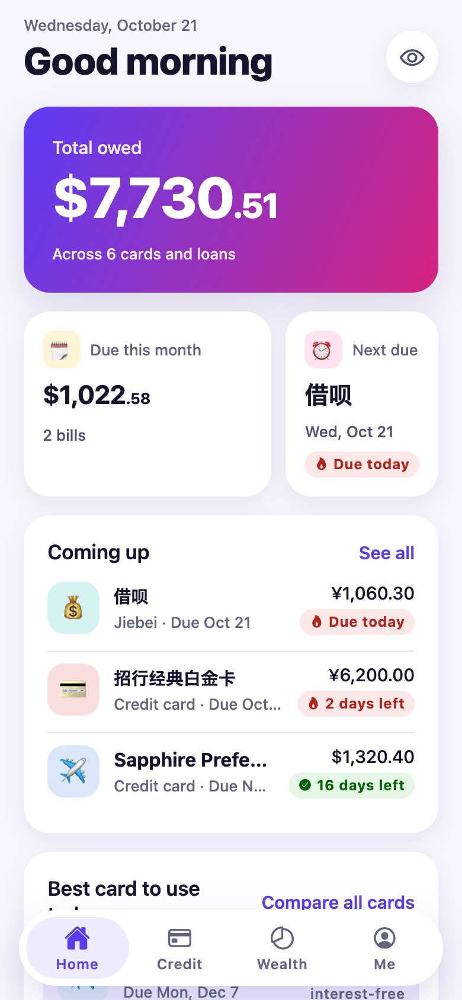
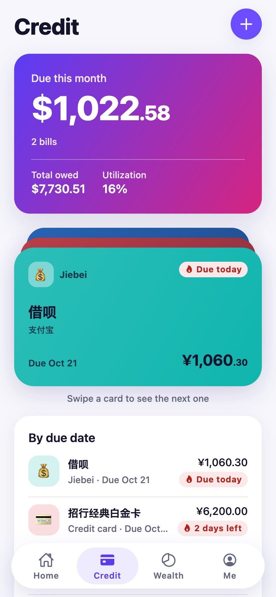
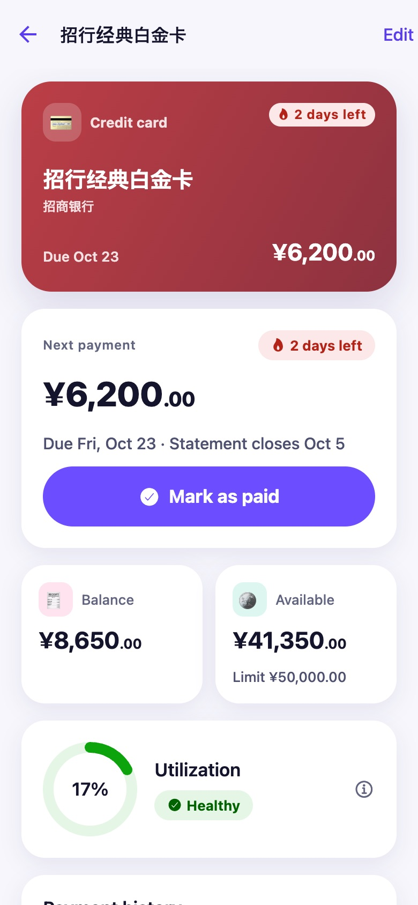
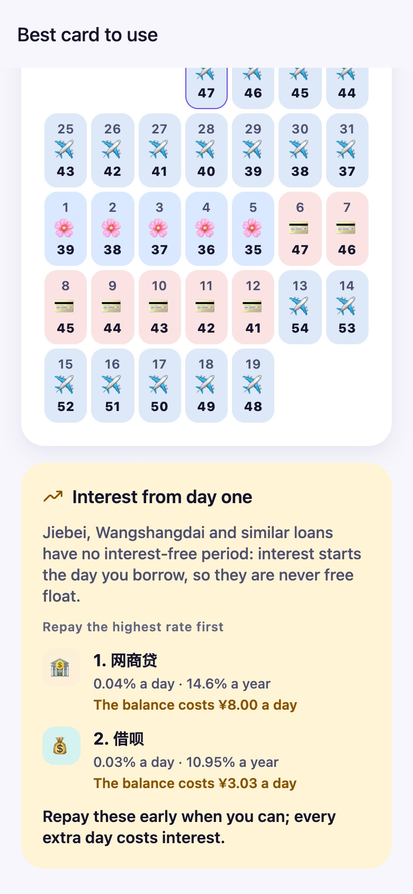
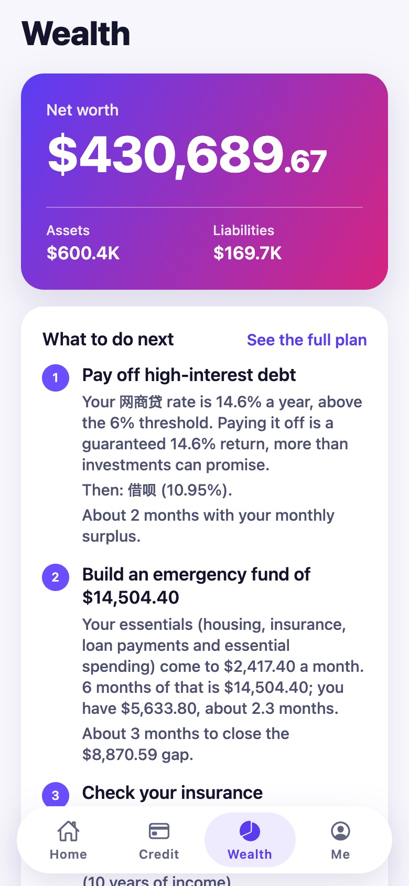
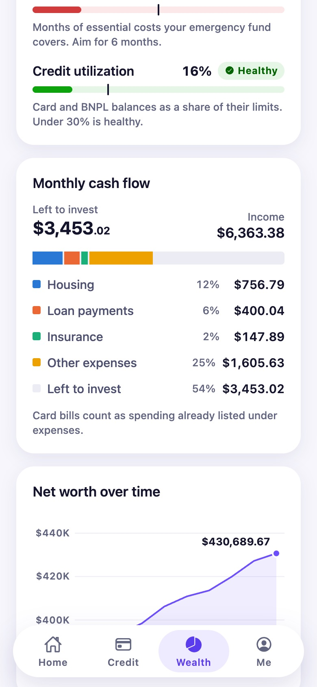
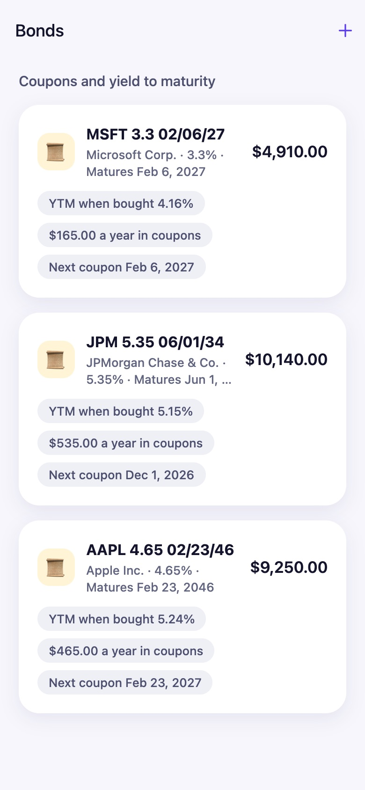
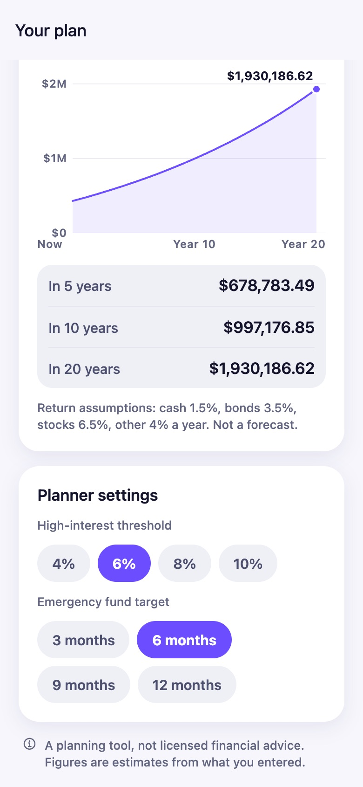
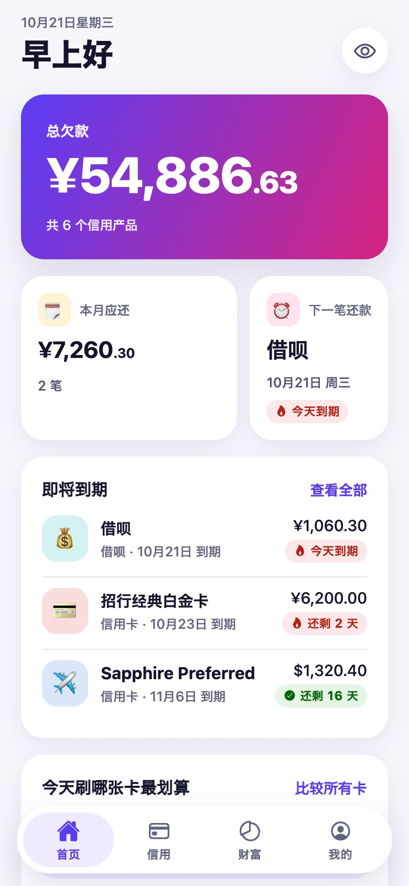

# Finance

A local-first personal finance app for one person, built with Expo (React Native) for iOS and
Android from a single codebase.

> This is a planning tool, not licensed financial advice.

## What it does

- **Every credit product in one list.** Credit cards from any bank or country plus Chinese
  consumer credit such as 花呗 (Huabei), 借呗 (Jiebei), 网商贷 (Wangshangdai), 京东白条 and
  微粒贷, sorted by the next due date, with local reminders before each one.
- **Best card to use today.** Ranks cards by interest-free days for a purchase made today, with a
  30-day calendar. Enter an amount and cards without enough limit left are set aside. Due dates on
  weekends and bank holidays (mainland China and the US) are flagged. Loans that charge daily
  interest from day one (借呗, 网商贷) are never ranked as "free float"; the app shows their real
  cost instead and lists them highest rate first, the order to repay them in.
- **Portfolio planner.** Income, credit debt, housing, insurance, cash, bonds and stocks feed a
  transparent rules engine (`src/domain/portfolioPlanner.ts`) that proposes an ordered plan:
  pay off debt above 6% APR, build a 6-month emergency fund, check insurance against income,
  then invest the surplus by your risk profile, with rebalancing. Every step spells out the
  figures behind it. The dashboard adds net worth and its monthly trend, cash flow, a 12-month
  passive-income calendar (bond coupons and dividends), five health ratios with traffic lights,
  and a what-if projection over 5, 10 and 20 years. No LLM, no network.
- **Private by design.** All data stays on the device in SQLite. No account, no backend, no
  analytics. An app lock (Face ID, fingerprint or passcode) guards it, and passphrase-encrypted
  backups let you move to a new phone.
- Simplified Chinese and English, multi-currency with a home currency and editable FX rates.

## Screenshots

Taken from the web preview at iPhone size, with the built-in demo data (nothing real).

| Home                                                                                                                     | Credit                                                                                                                         | Card detail                                                                                                                    |
| ------------------------------------------------------------------------------------------------------------------------ | ------------------------------------------------------------------------------------------------------------------------------ | ------------------------------------------------------------------------------------------------------------------------------ |
|  |  |  |

| Best card, next 30 days                                                                                                                    | Wealth dashboard                                                                                   | Cash flow and trend                                                                                    |
| ------------------------------------------------------------------------------------------------------------------------------------------ | -------------------------------------------------------------------------------------------------- | ------------------------------------------------------------------------------------------------------ |
|  |  |  |

| Bonds                                                                                             | What-if projection                                                                                | 简体中文                                                                                     |
| ------------------------------------------------------------------------------------------------- | ------------------------------------------------------------------------------------------------- | -------------------------------------------------------------------------------------------- |
|  |  |  |

## Status

| Phase | Scope                                                                   | State |
| ----- | ----------------------------------------------------------------------- | ----- |
| 1     | Project setup, design research, design system, navigation shell         | Done  |
| 2     | Credit products: data model, add/edit screens, countdown, notifications | Done  |
| 3     | Payment optimizer and "Best card to use today"                          | Done  |
| 4     | Portfolio inputs: income, housing, insurance, bonds, stocks, risk       | Done  |
| 5     | Portfolio planner engine, dashboard and charts                          | Done  |
| 6     | Polish: animations, i18n pass, app lock, backup/export, screenshots     | Done  |

## Run it

You need Node.js 20 or newer and npm. Then:

```bash
npm install
```

### On your phone with Expo Go (quickest)

1. Install **Expo Go** from the App Store or Google Play. The store version supports Expo SDK 58,
   which this project uses.
2. Start the dev server:

   ```bash
   npm start
   ```

3. Scan the QR code in the terminal: with the Camera app on iPhone, or from inside Expo Go on
   Android. Your phone and computer need to be on the same Wi-Fi network; if they cannot see each
   other, run `npm start -- --tunnel`.

Nothing is preloaded. To look around with sample cards and loans, open **Me → Load demo data**
(and **Remove demo data** to delete exactly those items again).

Expo Go limits worth knowing:

- **Face ID does not work in Expo Go on iOS**, so the app lock falls back to your device passcode
  there. Fingerprint unlock on Android works.
- Notifications are local only, which is all this app uses, so reminders work in Expo Go. The app
  asks for permission after you add your first card or loan; reminders fire at 09:00, 3 days and
  1 day before each due date by default (change both under **Me → Reminders**).

### With a development build

A development build is your own installable app with all native modules compiled in. Use it for
Face ID on iOS, or once you want an app icon on your home screen that does not depend on Expo Go.

With EAS Build (no Xcode or Android Studio needed):

```bash
npx eas-cli@latest login
npx eas-cli@latest init                      # links the project to your Expo account
npx eas-cli@latest build --profile development --platform ios      # or android
```

Install the build on your phone from the link EAS gives you, then start the dev server for it:

```bash
npm run start:dev
```

Or build locally if you have Xcode or Android Studio installed:

```bash
npx expo run:ios
npx expo run:android
```

### In a browser

```bash
npm run web
```

This opens the app in your browser at http://localhost:8081, with your data kept in that browser
(SQLite in WebAssembly). It works with the mouse and keyboard: hover states, a focus ring for
Tab navigation, ← / → on the card deck, Escape to close dialogs, and a centred layout on wide
windows. The dev server sends the cross-origin isolation headers SQLite needs; if you host a web
export yourself, your server must send `Cross-Origin-Opener-Policy: same-origin` and
`Cross-Origin-Embedder-Policy: credentialless` (or `require-corp`) too.

## Scripts

| Command               | What it does                                       |
| --------------------- | -------------------------------------------------- |
| `npm start`           | Dev server for Expo Go                             |
| `npm run start:dev`   | Dev server for a development build                 |
| `npm run web`         | Dev server that opens the app in a browser         |
| `npm test`            | Jest unit tests                                    |
| `npm run lint`        | ESLint with Prettier formatting rules              |
| `npm run typecheck`   | TypeScript in strict mode                          |
| `npm run check`       | All three of the above                             |
| `npm run format`      | Format everything with Prettier                    |
| `npm run db:generate` | New SQL migration after editing `src/db/schema.ts` |

## Project layout

```text
src/
  app/          Routes (expo-router). Every file is a screen; _layout files are navigators.
  components/   Design-system components: Card, StatTile, ProgressRing, DueBadge,
                AmountText, BottomSheet, EmptyState, TabBar, form fields, pickers, ...
  db/           SQLite schema (Drizzle), connection and migrations runner, repositories,
                live queries, demo data
  design/       Tokens (colour, type, spacing, radius, shadow, motion), theme, motion helpers
  domain/       Pure finance logic with unit tests: dates, billing cycles, loans, payments,
                payment optimizer, holidays, bonds (coupons, YTM), stocks, cash flow, risk
                profile, portfolio planner, FX, money formatting, form validation
  features/     Feature UI built from the components: credit (card art, card deck, product
                form, payment sheet, reminders), optimizer, wealth (generic input form),
                plan (dashboard cards); charts live in components/charts
  hooks/        useToday, useForm, useCountUp
  i18n/         English and Simplified Chinese strings, language detection
  lib/          Platform helpers (haptics, notifications, date formatting, dialogs)
  state/        App-wide state: database gate, preferences, credit data, toasts
drizzle/        Generated SQL migrations (bundled into the app as strings)
docs/
  design.md     Mobbin research and the design system it led to
```

## Privacy and security

- Data never leaves the phone unless you export a backup yourself. No analytics, crash reporting
  or network calls of any kind.
- **App lock** (Me → Security): Face ID, Touch ID or fingerprint, falling back to the device
  passcode. It locks at launch and after the app has been in the background longer than the delay
  you choose, and covers the screen in the app switcher. The setting lives in the OS
  keychain/keystore via `expo-secure-store`, so it is never part of a backup.
- **Backups** (Me → Backup and restore) are encrypted on the phone before you share them anywhere:
  scrypt (N = 2¹⁶, r = 8, p = 1) derives a key from your passphrase and XChaCha20-Poly1305 encrypts
  and authenticates every table plus your preferences. A wrong passphrase or a modified file is
  rejected; restoring replaces everything in one transaction. Without the passphrase a backup
  cannot be opened, so keep it safe. The format is documented in `src/lib/backup/crypto.ts`.
- Never commit real financial data: `.gitignore` blocks local databases, backups, `.env` files
  and signing keys.

## Notes and limits

- Prices, FX rates and bond prices are typed in by hand; the app never goes online.
- Bank holidays are flagged for mainland China (the published 2026 schedule, then fixed-date
  holidays for other years until the next schedule is added) and the US (computed rules).
- The planner's rules and thresholds are in `src/domain/portfolioPlanner.ts`, each covered by
  tests. Return assumptions are long-run guesses, not forecasts.
- Light theme only for now; colours go through theme tokens so a dark theme can follow.

## Design

See [docs/design.md](docs/design.md) for the reference apps studied on Mobbin, what was taken from
each, and the resulting design system (colour tokens with contrast ratios, type scale, motion
rules, accessibility).
